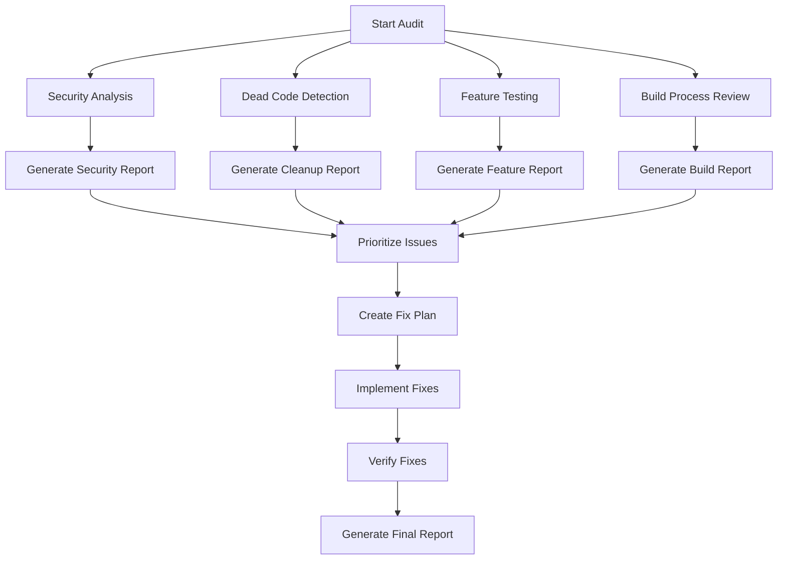

# Design Document

## Overview

This design document outlines the approach for auditing and fixing issues in the bahaerdogan.com website project. The solution involves a systematic analysis of the codebase, identification of issues across multiple categories, and implementation of fixes that improve security, performance, and maintainability.

The project consists of:
- **Frontend**: Static HTML/CSS/JS files hosted on GitHub Pages
- **Backend**: Cloudflare Workers for comments and contact form handling
- **Build System**: Node.js-based build script for minification and optimization
- **Infrastructure**: Cloudflare CDN, KV storage, and MailChannels for email

## Architecture

### Audit Process Flow



### Issue Categories

1. **Critical**: Security vulnerabilities, broken core features
2. **High**: Performance issues, dead code affecting functionality
3. **Medium**: Code quality issues, minor bugs
4. **Low**: Optimization opportunities, documentation gaps

## Components and Interfaces

### 1. Security Audit Module

**Purpose**: Identify and document security vulnerabilities

**Key Functions**:
- `scanForEmailJSReferences()`: Search HTML files for remaining EmailJS code
- `findConsoleStatements()`: Locate console.log in production JS
- `validateCSP()`: Check Content Security Policy configuration
- `checkDuplicateTags()`: Find duplicate canonical/hreflang tags
- `validateSecurityHeaders()`: Verify security header configuration

**Output**: Security audit report with severity ratings

### 2. Dead Code Detector

**Purpose**: Identify unused files, functions, and code

**Key Functions**:
- `scanUnusedImages()`: Find images not referenced in HTML/CSS
- `detectOrphanedFunctions()`: Find unused JavaScript functions
- `findUnusedLibraries()`: Identify unused third-party libraries
- `checkDuplicateFiles()`: Find duplicate or redundant files

**Output**: Dead code report with removal recommendations

### 3. Feature Validator

**Purpose**: Test all interactive features for functionality

**Key Functions**:
- `testCommentsSystem()`: Verify comments submission and display
- `testContactForm()`: Verify contact form submission
- `testLanguageSwitching()`: Verify language toggle functionality
- `testBlogSearch()`: Verify search functionality
- `validateDNSConfig()`: Check MailChannels DNS records

**Output**: Feature status report with pass/fail results

### 4. Build Process Analyzer

**Purpose**: Review and optimize the build process

**Key Functions**:
- `analyzeBuildScript()`: Review build.js for issues
- `checkMinification()`: Verify CSS/JS minification
- `validateSitemap()`: Check sitemap generation
- `reviewImageConversion()`: Verify WebP conversion process

**Output**: Build optimization recommendations

### 5. Fix Implementation Engine

**Purpose**: Apply fixes based on audit findings

**Key Functions**:
- `removeDuplicateTags()`: Clean up duplicate HTML tags
- `removeEmailJSReferences()`: Strip out old EmailJS code
- `removeConsoleStatements()`: Clean production JavaScript
- `createSecurityHeaders()`: Generate _headers file
- `optimizeBuildProcess()`: Update build.js

**Output**: Fixed files and change log

## Data Models

### Audit Report Structure

```javascript
{
  "auditDate": "2025-10-13",
  "projectName": "bahaerdogan.com",
  "categories": {
    "security": {
      "score": 8.5,
      "issues": [
        {
          "id": "SEC-001",
          "severity": "HIGH",
          "title": "EmailJS references in HTML",
          "description": "Found EmailJS code in 4 HTML files",
          "files": ["WhyToLearnHistoryTR.html", "..."],
          "recommendation": "Remove all EmailJS inline scripts",
          "status": "OPEN"
        }
      ]
    },
    "deadCode": {
      "score": 7.0,
      "issues": [...]
    },
    "features": {
      "score": 9.0,
      "tests": [...]
    },
    "build": {
      "score": 8.0,
      "issues": [...]
    }
  },
  "overallScore": 8.1,
  "summary": "..."
}
```

### Issue Tracking Model

```javascript
{
  "issueId": "SEC-001",
  "category": "security",
  "severity": "HIGH|MEDIUM|LOW",
  "title": "Brief description",
  "description": "Detailed description",
  "affectedFiles": ["file1.html", "file2.js"],
  "recommendation": "How to fix",
  "estimatedEffort": "1-2 hours",
  "status": "OPEN|IN_PROGRESS|FIXED|WONT_FIX",
  "fixedBy": "commit hash or PR number"
}
```

## Error Handling

### Audit Phase Errors

1. **File Access Errors**: If files cannot be read, log the error and continue with other files
2. **Parse Errors**: If HTML/JS parsing fails, mark file for manual review
3. **Network Errors**: If external resources cannot be validated, mark as "NEEDS_MANUAL_CHECK"

### Fix Implementation Errors

1. **Backup Strategy**: Create backups before modifying files
2. **Rollback Plan**: If fixes cause issues, provide rollback instructions
3. **Validation**: After each fix, validate that the file is still valid HTML/JS

## Testing Strategy

### 1. Security Testing

- **Static Analysis**: Scan code for known vulnerability patterns
- **Manual Review**: Review security-critical code sections
- **Penetration Testing**: Test XSS, CSRF, injection vulnerabilities

### 2. Feature Testing

- **Unit Tests**: Test individual functions (comments, contact form)
- **Integration Tests**: Test Cloudflare Worker endpoints
- **End-to-End Tests**: Test complete user flows
- **Cross-Browser Testing**: Verify functionality in major browsers

### 3. Performance Testing

- **Load Time Analysis**: Measure page load times before/after fixes
- **Bundle Size**: Compare file sizes before/after optimization
- **Lighthouse Audit**: Run Google Lighthouse for performance metrics

### 4. Build Testing

- **Build Verification**: Ensure build.js completes successfully
- **Output Validation**: Verify minified files are valid
- **Idempotency**: Ensure running build multiple times produces same result

## Implementation Phases

### Phase 1: Audit and Analysis (Current Phase)

1. Run comprehensive scans across all categories
2. Generate detailed audit reports
3. Prioritize issues by severity and impact
4. Create fix implementation plan

### Phase 2: Critical Fixes

1. Remove EmailJS references from HTML files
2. Fix duplicate canonical/hreflang tags
3. Remove console.log from production JS
4. Create security headers file

### Phase 3: Dead Code Cleanup

1. Remove unused images
2. Remove unused JavaScript functions
3. Remove unused library files
4. Clean up build artifacts

### Phase 4: Feature Fixes

1. Verify and fix comments system
2. Verify and fix contact form
3. Fix language switching issues
4. Validate MailChannels configuration

### Phase 5: Build Optimization

1. Fix duplicate tag generation in build.js
2. Optimize image conversion process
3. Improve sitemap generation
4. Add source map generation

### Phase 6: Verification and Documentation

1. Run all tests to verify fixes
2. Generate final audit report
3. Update project documentation
4. Create maintenance guidelines

## Specific Issue Resolutions

### Issue 1: Duplicate Canonical/Hreflang Tags in index.html

**Problem**: The build.js script's `updateI18nHeadsAndToggle()` function is not idempotent, causing duplicate tags on repeated builds.

**Solution**:
- Add proper duplicate detection before injecting tags
- Use more robust regex patterns to find existing tags
- Implement a "clean before inject" strategy

**Code Change**:
```javascript
// Before injecting, remove all existing canonical and hreflang tags
html = html.replace(/<link[^>]*rel=["']canonical["'][^>]*>/gi, '');
html = html.replace(/<link[^>]*rel=["']alternate["'][^>]*hreflang[^>]*>/gi, '');
// Then inject new tags
```

### Issue 2: EmailJS References in HTML Files

**Problem**: Old EmailJS code remains in some Turkish HTML files, creating security concerns.

**Solution**:
- Search for all EmailJS patterns in HTML files
- Remove inline scripts containing EmailJS
- Verify comments-system.js is properly loaded instead

**Files to Fix**:
- WhyToLearnHistoryTR.html
- MacShortcutsTR.html
- OguzKaganEpicTR.html
- PreciousMetalDataTR.html

### Issue 3: Console.log Statements in Production

**Problem**: Multiple console.log statements exist in production JavaScript files.

**Solution**:
- Remove console.log from production JS files
- Keep console.error for critical errors
- Consider adding a development flag wrapper

**Approach**:
```javascript
// Wrap console statements
if (typeof DEBUG !== 'undefined' && DEBUG) {
  console.log('Debug info');
}
```

### Issue 4: Missing Security Headers

**Problem**: No _headers file for Cloudflare Pages deployment.

**Solution**:
- Create _headers file with comprehensive security headers
- Include CSP, HSTS, X-Frame-Options, etc.
- Test headers after deployment

**File Content**:
```
/*
  X-Frame-Options: DENY
  X-Content-Type-Options: nosniff
  Referrer-Policy: strict-origin-when-cross-origin
  Permissions-Policy: geolocation=(), microphone=(), camera=()
  Content-Security-Policy: default-src 'self'; script-src 'self' https://www.googletagmanager.com; ...
```

### Issue 5: Unused Images

**Problem**: Many images exist in both original and WebP formats, some may be unused.

**Solution**:
- Scan all HTML and CSS files for image references
- Create list of referenced images
- Identify unreferenced images for potential removal
- Verify before deletion (some may be dynamically loaded)

## Performance Considerations

### Before Fixes

- **index.html size**: ~50KB (with duplicate tags)
- **Total JS size**: ~200KB (with console.logs)
- **Unused images**: ~50MB estimated

### After Fixes (Expected)

- **index.html size**: ~45KB (5% reduction)
- **Total JS size**: ~195KB (2.5% reduction)
- **Unused images removed**: ~50MB (20% of total)
- **Page load time**: 5-10% improvement expected

## Security Improvements

### Current Security Score: 9.2/10

**Remaining Issues**:
1. EmailJS references (HIGH)
2. Console.log statements (LOW)
3. Missing security headers (MEDIUM)
4. Duplicate tags (LOW)

### Target Security Score: 9.8/10

**After Fixes**:
1. ✅ All EmailJS removed
2. ✅ Production console.logs removed
3. ✅ Security headers added
4. ✅ Duplicate tags removed
5. ✅ CSP tightened

## Maintenance Guidelines

### Regular Audits

- **Monthly**: Run automated security scans
- **Quarterly**: Full manual audit
- **After Major Changes**: Targeted audit of affected areas

### Build Process

- **Pre-commit**: Run linters and formatters
- **Pre-push**: Run build and verify output
- **Post-deploy**: Run smoke tests

### Monitoring

- **Error Tracking**: Monitor Cloudflare Worker logs
- **Performance**: Track Core Web Vitals
- **Security**: Monitor for new vulnerabilities in dependencies
